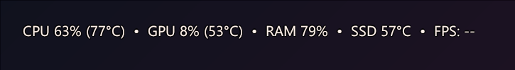
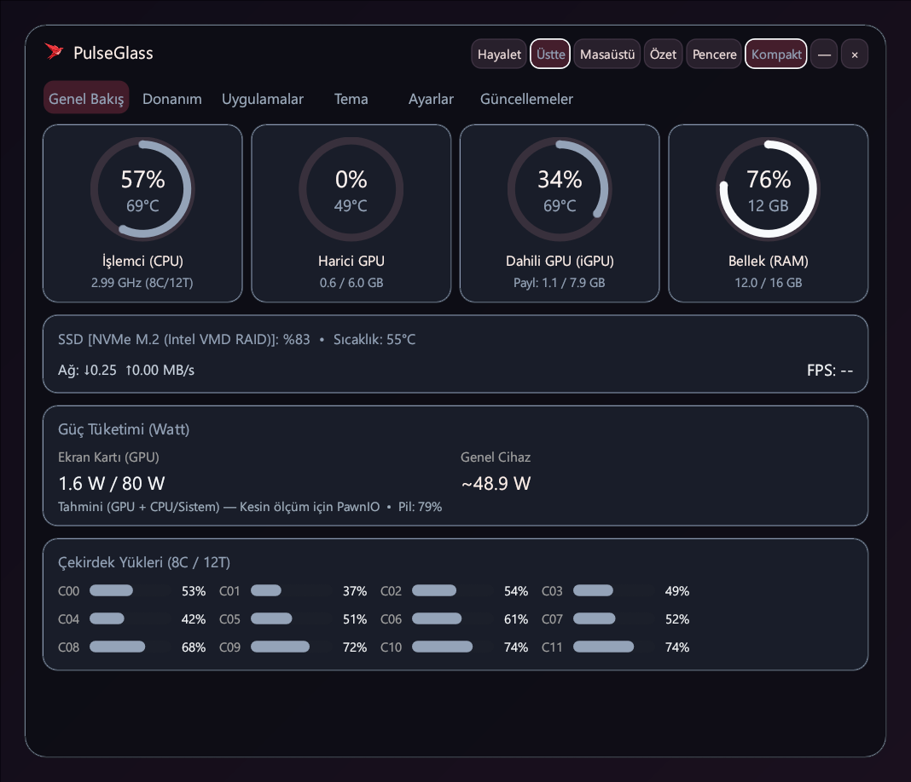

# PulseGlass Hardware Monitor (`v1.3.0`)

A lightweight, glassmorphic Windows desktop hardware monitor, overlay strip, and system utility built with C# and WPF (.NET Framework).

---

## 📸 Screenshots

### Compact Widget & Summary Strip (`Mini Mode`)
| Compact Widget | Summary Strip (with Live FPS) |
| :---: | :---: |
|  |  |

### Detailed Dashboard
| Overview | Update Center (Important & Optional) |
| :---: | :---: |
|  |  |

### Settings, Themes & Customization


---

## ✨ Key Features

- **Three Seamless Display Modes**
  - **Compact Widget:** Circular gauges for CPU, Discrete GPU, Integrated GPU (iGPU), and RAM, plus SSD/Network telemetry and quick shortcuts.
  - **Summary Strip (`Mini Mode`):** Ultra-compact single-line overlay with **live FPS** (built-in Windows DXGI ETW + RTSS fallback) and **customizable metrics** (`CPU %`, `CPU °C`, `GPU %`, `GPU °C`, `iGPU %`, `RAM %`, `SSD °C`, `FPS`) configurable in Settings.
  - **Detailed Window:** Full tabbed dashboard for Overview, Hardware Details, Processes, Settings, and Updates.
- **Ghost Mode (Click-Through):** Toggle click-through transparency at any time with `Shift + Enter` so the widget stays visible without blocking clicks.
- **Middle-Click Drag & Desktop Pin:** Drag the widget from anywhere using the middle mouse button, or pin it to the desktop / keep it always on top.
- **Process Manager:** Search, sort, and group running apps, and right-click any process to open its file location, copy its path, or terminate it immediately.
- **Built-in Update Center:**
  - Automatically checks for updates at startup and every **6 hours**, with a manual **Check Now** button in the **Updates** tab.
  - Separates **Important / Recommended Windows Updates** from **Optional Windows Updates** using the native Windows Update Agent (`Microsoft.Update.Session`).
  - Checks for new **PulseGlass** releases and downloads/installs updates **only after explicit user confirmation**.
- **Bilingual UI & Custom Themes:** Switch between **English** and **Türkçe** in Settings, and customize widget/window opacity, UI scale, alert thresholds, and color palettes (5 presets + custom Hex editor).

---

## 🚀 Getting Started

### Option 1: Download Prebuilt Binary
1. Go to the [**Releases**](https://github.com/yafermys/PulseGlass/releases) page.
2. Download `PulseGlassWidget.exe`. Libraries are embedded in the exe. Releases up to v1.3.0 also need `LibreHardwareMonitorLib.dll` in the same folder.
3. Run `PulseGlassWidget.exe` (Windows 10 / 11 x64, .NET Framework 4.7.2 or later).
   - *Administrator Privileges:* PulseGlass requests Administrator elevation on launch so the built-in **DXGI ETW FPS counter** and **LibreHardwareMonitorLib** storage/CPU temperature sensors work out of the box without external tools like RTSS.
   - *CPU temperature:* LibreHardwareMonitorLib reads CPU sensors through the [PawnIO](https://pawnio.eu) driver. If CPU temperature is missing, install PawnIO once and restart PulseGlass.

### Option 2: Build from Source
```powershell
MSBuild.exe PulseGlassWidget.csproj /p:Configuration=Release /p:Platform=x64 /p:OutDir=Release_Publish\
```

---

## 🛠 Tech Stack

- **Language & UI:** C# / WPF (.NET Framework 4.7.2)
- **System Telemetry:** `LibreHardwareMonitorLib` (`0.9.6`, PawnIO), Windows DXGI ETW (`Microsoft-Windows-DXGI`), Windows API (`GlobalMemoryStatusEx`, `GetSystemTimes`, `GetPhysicallyInstalledSystemMemory`), WMI, Performance Counters, and `RTSSSharedMemoryV2` fallback
- **Updates:** Windows Update Agent COM (`Microsoft.Update.Session`) & GitHub Releases API

---

## 📄 License

This project is licensed under the MIT License.
