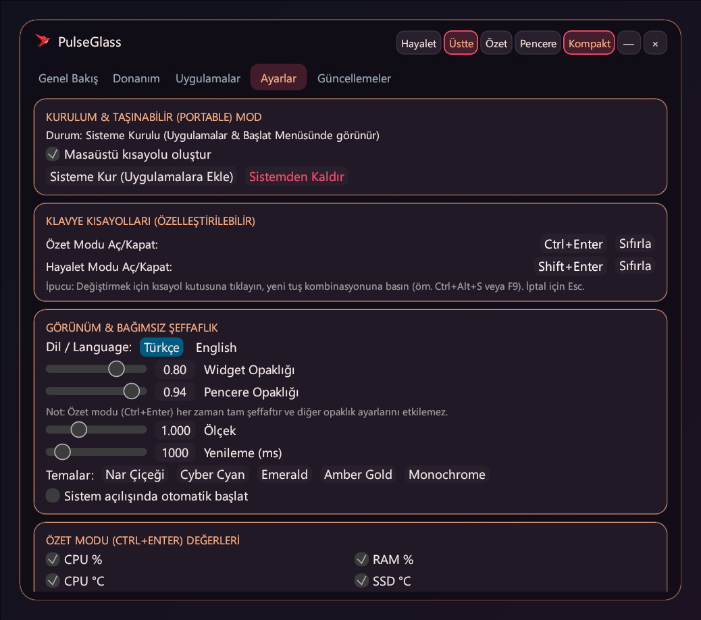

# PulseGlass Hardware Monitor (`v2.0.0` — Rust Edition)

A blazing-fast, ultra-lightweight, glassmorphic desktop hardware monitor, pure OSD summary strip, and system utility rewritten from scratch in **Rust** (`egui`/`eframe`) for **Windows** and **Linux**.

---

## 📸 Screenshots

### Compact Widget & Summary Strip (Customizable Hotkey, default `Ctrl + Enter`)
| Compact Widget | Summary Strip (Pure OSD) |
| :---: | :---: |
|  |  |

### Detailed Dashboard
| Overview | Update Center (Important & Optional) |
| :---: | :---: |
|  |  |

### Settings, Customizable Hotkeys, Themes & Installer


---

## ✨ What's New in `v2.0.0`

- **Rewritten in Rust for Maximum Efficiency:** Native compiled single binary with thin LTO, background telemetry worker thread, zero runtime `.dll` dependencies, embedded multi-resolution app icon across Explorer/Taskbar/Alt+Tab/Start Menu/Installed Apps, and minimal CPU/RAM overhead.
- **Customizable Global Hotkeys (Windows & Linux):**
  - Rebind both **Summary OSD** (default `Ctrl + Enter`) and **Ghost Click-Through** (default `Shift + Enter`) directly from **Settings → Global Hotkeys** with live key capture and one-click reset.
- **Multi-Monitor-Aware Screen Clamping:**
  - In every mode (Compact, Detailed, Summary OSD, and Application Window), PulseGlass can never move or resize off-screen while still allowing smooth dragging across connected monitors.
- **Built-In Multi-Provider ETW FPS Monitor (Zero External Tools Required):**
  - Supports **RTSS** (when running) plus a built-in PresentMon-grade **Windows ETW** engine (`Microsoft-Windows-DXGI`, `Microsoft-Windows-D3D9`, and `Microsoft-Windows-DxgKrnl`) with kernel-side Event ID filtering and hardware QPC timestamps for DX9/10/11/12, OpenGL, and Vulkan games.
- **Cross-Platform (Windows 10/11 & Linux):**
  - **Windows:** Direct Win32 NVML FFI (`nvml.dll`, zero `nvidia-smi` process spam), native `pdh.dll` CPU thermal & Turbo clock counters (zero PowerShell flashes), native Windows Energy Meter Interface (**EMI**), `StorageDeviceProtocolSpecificProperty` NVMe SMART temperature (works even through Intel VMD `iaStorVD` RAID 0 volumes!), and `CallNtPowerInformation` battery wattage.
  - **Linux (Ubuntu, Debian, Fedora, Arch, etc. — X11 & Wayland):** Native `/sys/class/hwmon`, `/sys/class/powercap/intel-rapl`, `/sys/class/drm` AMD/Intel GPU telemetry + NVIDIA GPU wattage, `/sys/block` M.2 NVMe / SATA / USB detection, and `/sys/class/power_supply` battery wattage.
- **No WinRing0 (Windows Defender Friendly):** Incorporates [PR #1](https://github.com/yafermys/PulseGlass/pull/1) and [PR #2](https://github.com/yafermys/PulseGlass/pull/2) by **[@misutesu-desu](https://github.com/misutesu-desu)**:
  - Zero `WinRing0` driver usage (no `VulnerableDriver:WinNT/Winring0` alerts).
  - Detects optional [PawnIO](https://pawnio.eu) driver on Windows and opens the download link via `explorer.exe` without inheriting elevated privileges.
  - Hardened self-updater: strictly selects the platform executable asset (never falls back to release API JSON) and verifies `MZ` (Windows PE) / `\x7fELF` (Linux ELF) binary headers before replacing.
  - Cleans up stale `LibreHardwareMonitorLib.dll` files left next to the executable from `v1.3.0`.
- **Detailed Storage Identification:** Clearly distinguishes **NVMe M.2**, **NVMe M.2 (Intel VMD RAID)**, **SATA SSD**, **SATA HDD**, and **USB** drives along with live per-drive temperature.
- **Live GPU & Total Device Wattage:** Displays live **GPU Power Draw (W / TDP)** and **Total Device Power Draw (W)** across Compact Widget, Overview, Hardware Details, and Summary OSD.
- **Independent Opacities & Pure Summary OSD:**
  - **Summary OSD:** Always 100% transparent, zero title bar/borders/buttons — shows **only** your chosen metrics with crisp drop shadows.
  - **Widget Opacity** and **Window Opacity** are completely independent and never affect each other or the Summary OSD.
  - **Ghost Click-Through Mode**: Click right through the overlay while gaming or working.
- **Installed App Mode AND Portable Mode:**
  - **System Installer (`PulseGlass-Setup.exe` or `PulseGlass.exe --install` or Settings → Install):** Installs PulseGlass into **Windows Installed Apps (Settings → Apps)** + Start Menu + optional Desktop shortcut, with full uninstaller support (`--uninstall`). On Linux, installs to `~/.local/bin/pulseglass` and registers a `.desktop` launcher + hicolor icon.
  - **Portable Mode (`PulseGlass.exe` / `--portable`):** Run directly from any folder with zero installation!

---

## 🚀 Getting Started

### Windows
- **Option A — System Installer (Appears in Windows Installed Apps & Start Menu):**
  Download and run `PulseGlass-Setup.exe` from [**Releases**](https://github.com/yafermys/PulseGlass/releases) (also lets you extract Portable mode).
- **Option B — Portable (Single Executable):**
  Download `PulseGlass.exe` from [**Releases**](https://github.com/yafermys/PulseGlass/releases) and run it directly. You can also install it into Windows Apps anytime from **Settings → Install to OS Apps**.

### Linux
1. Download `pulseglass-linux-x86_64` from [**Releases**](https://github.com/yafermys/PulseGlass/releases) (or build from source below).
2. Make it executable and run portable:
   ```bash
   chmod +x pulseglass-linux-x86_64
   ./pulseglass-linux-x86_64
   ```
3. Or install to your desktop menu (`~/.local/bin/pulseglass` + `.desktop`):
   ```bash
   ./pulseglass-linux-x86_64 --install
   ```

### Build from Source (Windows & Linux)
```bash
# Portable executable
cargo build --release --bin PulseGlass

# Windows standalone setup wizard (embeds target/release/PulseGlass.exe)
cargo build --release --bin PulseGlass-Setup --features embed-app
```

---

## 📄 License

This project is licensed under the MIT License.
