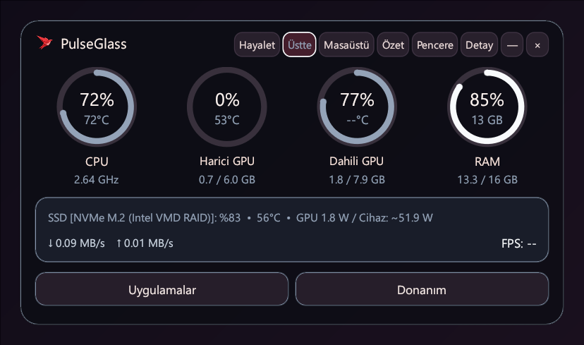
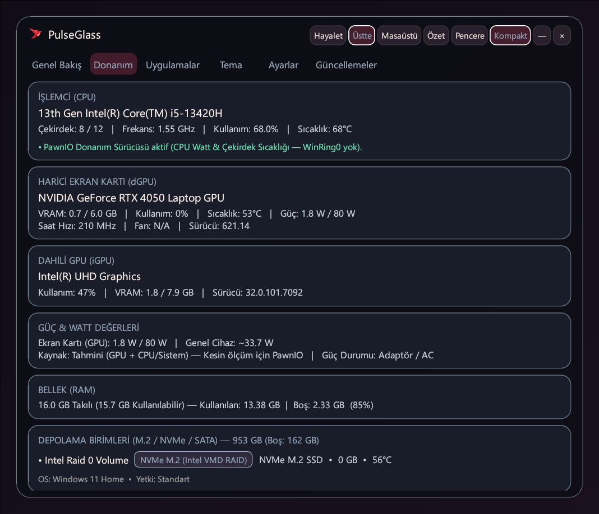
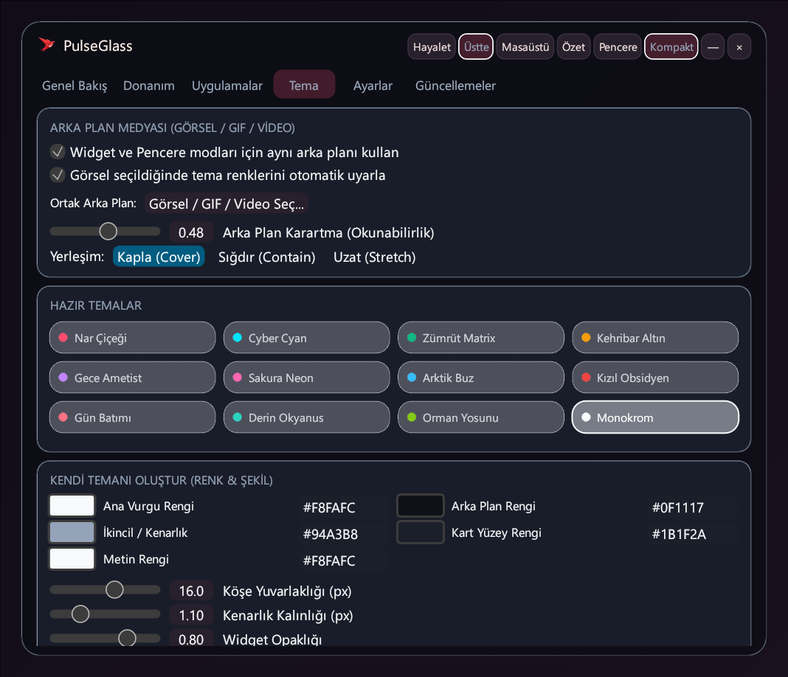
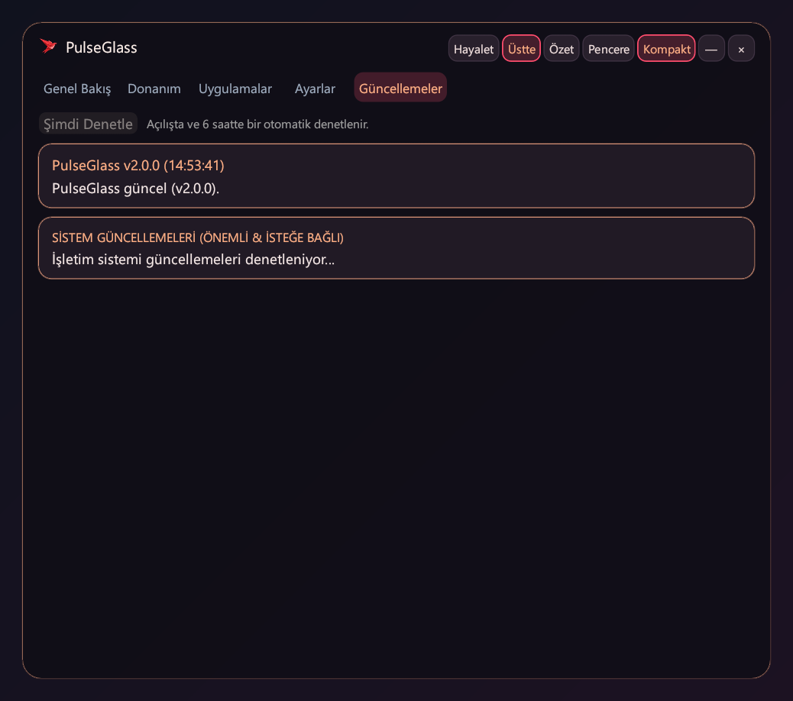

# PulseGlass Hardware Monitor (`v2.1.0` — Rust Edition)

A blazing-fast, ultra-lightweight, glassmorphic desktop hardware monitor, pure OSD summary strip, customizable theme & animated background studio, and system utility rewritten from scratch in **Rust** (`egui`/`eframe`) for **Windows** and **Linux**.

---

## 📸 Screenshots

### Compact Widget & Summary Strip (Customizable Hotkey, default `Ctrl + Enter`)
| Compact Widget | Summary Strip (Pure OSD) |
| :---: | :---: |
|  |  |

### Detailed Dashboard & Hardware Details
| Overview | Hardware Details (NVMe M.2, GPU, PawnIO) |
| :---: | :---: |
|  |  |

### Theme & Media Studio (Images / Animated GIF / Video + Auto-Palette + 12 Presets)


### Settings & Update Center
| Settings (Hotkeys, Safe Scaling, Summary Font Size) | Update Center |
| :---: | :---: |
|  |  |

---

## ✨ What's New in `v2.1.0`

- **Dedicated Theme & Background Media Studio (`Tema` Tab):**
  - Add custom **Images** (`.png`, `.jpg`, `.webp`, `.bmp`), **Animated `.gif`**, or **Video** (`.mp4`, `.webm`, `.mkv`, `.mov` via `ffmpeg`) backgrounds — synced across all modes or configured separately for **Widget** vs **Window**!
  - **Automatic Palette Extraction:** Automatically computes a harmonious, legible theme palette directly from your chosen background image/GIF/video.
  - **12 Curated Visual Themes** + **Full Custom Theme Studio** (interactive color pickers for Primary, Secondary, Background, Card Surface, and Text colors, plus Corner Radius & Border Width sliders).
- **Integrated Signed PawnIO Driver (Zero WinRing0):**
  - Embeds officially signed `IntelMSR.bin` and `AMDFamily17.bin` PawnIO modules directly inside PulseGlass with **1-click in-app PawnIO driver installation** for exact hardware Intel/AMD RAPL CPU Package Wattage, Intel PSys Platform Wattage, and hardware CPU Package Temperature.
  - Live **Total Device Wattage** now reports continuously on both Battery and AC power!
- **Silky-Smooth Value Transitions:**
  - Frame-rate-independent exponential smoothing glides circular gauges, per-core bars, clocks, and telemetry smoothly without harsh jumps.
- **Any-Key Customizable Global Hotkeys & Summary Font Size:**
  - Bind **any single key or key combination** (`Ctrl`, `Shift`, `Alt`, `Win` + key) for both Summary OSD and Ghost Click-Through mode.
  - Customize **Summary OSD Font Size (`9–28 pt`)** independently of UI scaling.
- **Crash-Proof UI Scaling (Excludes Summary OSD) & Multi-Monitor Screen Clamping:**
  - Safe scaling across Compact, Detailed, and Full Window modes while keeping Summary OSD untouched, plus automatic multi-monitor-aware boundary clamping so PulseGlass never escapes any screen edge while crossing smoothly between monitors.
- **Process Manager Fixes & Sorting:**
  - **Ascending / Descending (`▲`/`▼`)** sorting via toolbar toggle or clickable column headers (`Process`, `CPU`, `RAM`, `Disk`).
  - Fixed grouped app termination (terminates all grouped PIDs cleanly via Win32) and fixed **Open File Location** (`explorer.exe /select,"..."` raw argument handling + `QueryFullProcessImageNameW` fallback).
- **Pin-to-Desktop (`Masaüstü`), Save/Cancel/Reset Settings, Multi-Provider ETW FPS, & Windows Native-TLS Updater.**
- **Multi-Format Linux Release Packages:** Now distributed as `.deb` (Ubuntu/Debian), `.rpm` (Fedora/openSUSE), `.AppImage`, `.tar.gz`, and standalone `pulseglass-linux-x86_64`.

---

## 🚀 Getting Started

### Windows
- **Option A — System Installer (Windows Installed Apps & Start Menu):**
  Download and run `PulseGlass-Setup.exe` from [**Releases**](https://github.com/yafermys/PulseGlass/releases) (also lets you extract Portable mode).
- **Option B — Portable (Single Executable):**
  Download `PulseGlass.exe` from [**Releases**](https://github.com/yafermys/PulseGlass/releases) and run it directly. You can also install it into Windows Apps anytime from **Settings → Install to OS Apps**.

### Linux
Download the package for your distribution from [**Releases**](https://github.com/yafermys/PulseGlass/releases):
- **Ubuntu / Debian / Mint / Pop!_OS:** `sudo apt install ./pulseglass_2.1.0_amd64.deb`
- **Fedora / RHEL / openSUSE:** `sudo dnf install ./pulseglass-2.1.0-1.x86_64.rpm`
- **Universal AppImage:** `chmod +x PulseGlass-2.1.0-x86_64.AppImage && ./PulseGlass-2.1.0-x86_64.AppImage`
- **Arch / Universal Tarball:** Extract `pulseglass-2.1.0-linux-x86_64.tar.gz` and run `./pulseglass` (or `./install.sh` to add to your desktop menu)
- **Standalone Portable Binary:** `chmod +x pulseglass-linux-x86_64 && ./pulseglass-linux-x86_64`

### Build from Source (Windows & Linux)
```bash
# Portable executable
cargo build --release --bin PulseGlass

# Windows standalone setup wizard (embeds target/release/PulseGlass.exe)
cargo build --release --bin PulseGlass-Setup --features embed-app
```

---

## 📄 License

This project is licensed under the MIT License.
